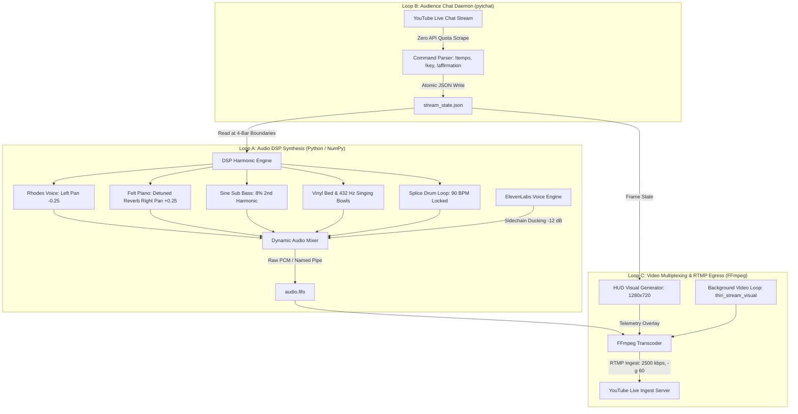

# 24/7 Agentic Radio Station: Technical Architecture

## Overview
The 24/7 Autonomous Agentic Radio Station architecture isolates three asynchronous loops to guarantee continuous broadcast stability with zero laptop load and sub-second chat responsiveness.

## Core Design Principles

1. **Loop Isolation & Zero Dropouts**:
   Audio DSP generation runs strictly ahead of time in 4-bar chunks (~10.667 seconds at 90 BPM). Chat ingestion never interrupts an active chunk; changes take effect cleanly at musical turnaround points.

2. **2-Second Keyframe Synchronization**:
   FFmpeg enforces strict 2.0-second GOP (`-g 60` at 30 fps) to maintain seamless ingestion with YouTube Live ingest servers without buffering.

3. **Atomic File-Based State Machine**:
   `stream_state.json` serves as the thread-safe communication bus between the Python chat listener, the DSP harmonic engine, and the visual overlay renderer.
